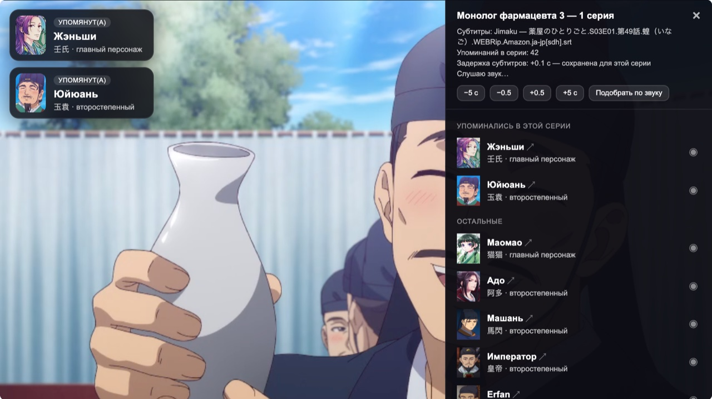
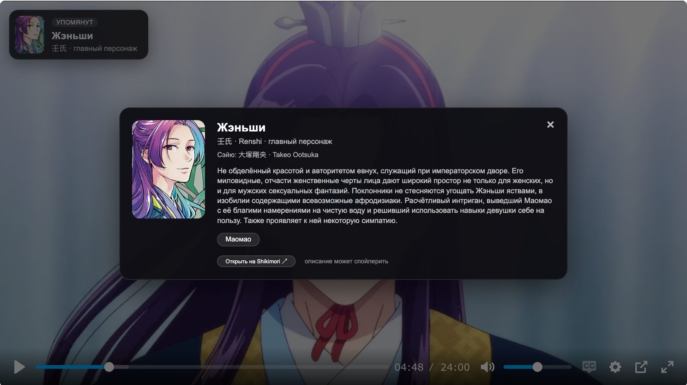
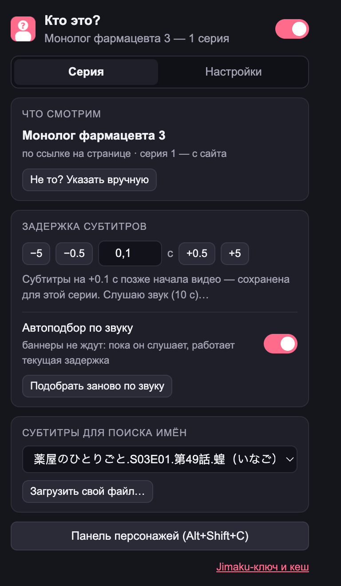
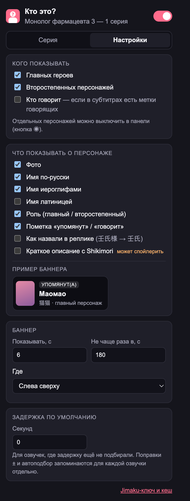

# Кто это? — подсказки персонажей аниме

Расширение для Chrome: когда в серии называют персонажа, в углу плеера появляется баннер с его фото, именем по-русски, японским написанием и ролью. Клик по баннеру ставит видео на паузу и открывает карточку персонажа. Плюс панель «Кто есть кто» со всеми персонажами сезона, где сверху — те, кого уже упоминали в этой серии, включая героев прошлых сезонов.






<p>
  
  
</p>

<sub>Скриншоты сделаны на YummyAnime: «Монолог фармацевта 3», 1 серия, плеер Alloha, озвучка AniLibria.</sub>

Где работает:
- **YummyAnime** — все плееры: Kodik, CVH, Alloha, Aksor, VK. Номер серии и озвучку расширение берёт из API самого сайта, поэтому неважно, как устроен плеер.
- **DreamCast** (dreamerscast.com) — аниме ищется на Shikimori по названию страницы, русское и японское название ищутся по отдельности. Серия берётся из выбранного пункта плейлиста, озвучка — Dream Cast. Проверено на живом сайте.
- Если аниме или серия определились неправильно, их можно указать вручную в окне расширения («Что смотрим»). Выбор запоминается для этой страницы.

Озвучка любая.

## Установка

Проще всего — из [Chrome Web Store](https://chromewebstore.google.com/detail/hnddlhnenonpacngglndclikeinhdcko): нажмите «Установить», обновления придут сами. Новые версии появляются в магазине после модерации, обычно через несколько дней после релиза на GitHub.

Или вручную, как распакованное расширение:

1. Скачайте `anime-who-<версия>.zip` из [последнего релиза](https://github.com/AlexLukashenko/anime-who/releases/latest) и распакуйте в отдельную папку. Или `git clone https://github.com/AlexLukashenko/anime-who.git` — тогда нужна папка `extension`.
2. Откройте `chrome://extensions`.
3. Включите «Режим разработчика» (переключатель справа сверху).
4. Нажмите «Загрузить распакованное расширение» и выберите распакованную папку (или `extension` из репозитория).
5. Откройте серию на YummyAnime (любой плеер) или на DreamCast и запустите видео.

При установке Chrome предупредит, что расширение может «читать и изменять данные на всех сайтах». Это нужно потому, что плееры встраиваются с разных и часто меняющихся доменов. Внутри скрипт сразу выключается, если ни сам фрейм, ни страница вокруг не относятся к YummyAnime, DreamCast или Shikimori.

## Как пользоваться

Баннеры появляются сами с первой секунды. Время считается от текущего момента видео, поэтому можно начинать с середины и перематывать: пропущенные упоминания не вываливаются пачкой, показ продолжается с нового места.

**Окно расширения, вкладка «Серия»:**
- **Что смотрим** — какое аниме и какая серия определились и откуда. Кнопка «Не то? Указать вручную»: ссылка на Shikimori/MyAnimeList (или ID) и номер серии.
- **Задержка субтитров.** У студий озвучки бывает своя заставка в начале, поэтому субтитры отстают от видео. Кнопки ±0.5/±5 с или ввод числа. Поправка запоминается для этой озвучки, следующие серии начинаются уже с неё.
- **Автоподбор по звуку** (тумблер, включён по умолчанию). Расширение слушает звук серии и уточняет задержку, обычно за 40–60 секунд. Баннеры его не ждут: пока он работает, действует текущая задержка — сохранённая или из настроек. Ручную правку автоподбор не перебивает, пока не нажать «Подобрать заново по звуку» (или Alt+Shift+S).
- Выбор файла субтитров или загрузка своего `.srt/.ass`.

**Вкладка «Настройки»:**
- **Кого показывать:** главных героев, второстепенных, «кто говорит» (по меткам говорящих в субтитрах).
- **Без спойлеров в панели** (по умолчанию выключено): в списке «Кто есть кто» остаются только персонажи, которых уже называли в этой серии, в прошлых сериях сезона или в прошлых сезонах. Остальные скрыты, пока их не назовут. Для этого расширение один раз скачивает субтитры прошлых серий и запоминает, кто в них был.
- **Что показывать о персонаже:** фото, имя по-русски, иероглифами, латиницей, роль, пометку «упомянут(а)/говорит», как назвали в реплике, краткое описание с Shikimori. Род в пометке берётся из AniList («упомянут» / «упомянута»); если он неизвестен, остаётся «упомянут(а)». Спойлерные блоки из описания вырезаются, но оно всё равно может спойлерить — поэтому по умолчанию выключено. Внизу виден пример баннера — с персонажем текущей серии, если она уже определилась.
- Длительность баннера, как часто повторять одного персонажа, положение на экране, задержка по умолчанию.

**В плеере:**
- **«Не он» / «не она»** — кнопка на баннере, появляется при наведении. Если слово в реплике — не имя этого персонажа (совпало с обычным словом), баннер исчезнет, и по этому слову персонаж больше не будет показываться в этом аниме. Сразу после нажатия можно «Отменить», а позже — «вернуть» в панели у этого персонажа.
- **Клик по баннеру** ставит видео на паузу и открывает карточку: крупное фото, имена, роль, японский сэйю, описание с Shikimori и связанные персонажи (клик по ним открывает их карточку). Закрыть — × , клик мимо карточки или Esc; видео продолжится само.
- **Alt+Shift+C** открывает панель персонажей. Её же открывает кнопка с иконкой людей справа сверху, она появляется при движении мыши. В панели есть кнопки ± для задержки, короткое название файла субтитров (полное — во всплывающей подсказке). Клик по имени или фото открывает карточку, ↗ рядом с именем — страницу на Shikimori в новой вкладке. Кнопка ◉ у персонажа выключает его баннеры в этом аниме.
- **Персонажи прошлых сезонов.** Если в серии назвали персонажа, которого нет в списке текущего сезона, но он был в прошлых, баннер всё равно появится — с пометкой «из прошлых сезонов» и названием сезона.

## Как это устроено

1. **Какое аниме открыто.** На странице YummyAnime есть ссылка на Shikimori/MyAnimeList, из неё берётся ID. Номер серии, озвучку и плеер текущего iframe даёт API сайта (`/api/anime/{id}/videos`, сопоставление по адресу плеера). На других сайтах — поиск по названию на Shikimori, серия из адреса или со страницы. Ручной выбор в окне расширения важнее всего.
2. **Персонажи.** Из Shikimori (GraphQL) берутся русские имена, японское написание, фото, роль и цепочка приквелов (до 4 сезонов назад) — их персонажи тоже ищутся в репликах, но имя, совпадающее с персонажем текущего сезона, остаётся за ним. Из AniList — дополнительные варианты японских имён, пол и японский сэйю. Общего ID персонажей у Shikimori и AniList нет, поэтому они сверяются по именам: латиницей и иероглифами, целиком и по частям («漢 羅漢» ↔ «羅漢» — Shikimori пишет китайское чтение Luohan, AniList японское Rakan), с учётом персонажей AniList из прошлых сезонов. Совпадение, общее для двух персонажей, не используется. Описание и связи для карточки — из Shikimori REST (`/api/characters/{id}`).
3. **Субтитры.** С [Jimaku](https://jimaku.cc) скачиваются японские субтитры к нужной серии. Расширение умеет разбирать нумерацию вида `S3 - 01`, `- 49`, `S03E49`, `第49話` и выбирает лучший файл: веб-релиз `.srt`, без двуязычных.
4. **Имена в репликах.** Субтитры очищаются от фуриганы, ремарок и меток говорящих. Затем в тексте ищутся японские имена персонажей. Фамилия, общая у нескольких персонажей, не используется. Нарицательные «имена» вроде 旦那 («хозяин») или 長男 («старший сын») тоже не используются.
5. **Задержка.** Время видео = время субтитров + задержка. Задержка берётся в таком порядке: сохранённая для этой серии → для этого аниме с этой озвучкой → для этой озвучки вообще → значение по умолчанию из настроек. Баннеры показываются по `currentTime` видео, поэтому просмотр с середины и перемотка работают.
6. **Подбор по звуку.** Расширение берёт звук плеера через `captureStream`. Детектор речи Silero VAD (ONNX, работает в браузере) отмечает моменты, где есть голос, и ищет задержку, при которой речь лучше всего совпадает с субтитрами (корреляция, как в ffsubsync/alass). Обычно на это уходит 40–60 секунд просмотра; перемотки при этом не мешают. Если плеер не отдаёт звук напрямую, расширение предложит «Слушать звук вкладки» (`tabCapture`).

Звук никуда не отправляется: вся обработка идёт в браузере. В сеть уходят только запросы к Shikimori, AniList и Jimaku.

Кеш ответов этих сервисов лежит в `chrome.storage.local` и чистится сам: устаревшие записи удаляются при запуске браузера и не чаще раза в час во время работы, а если кеш больше 40 МБ — уходят самые старые. Задержки, ручной выбор, выключенные персонажи и свои субтитры не удаляются. Очистить кеш целиком можно в настройках расширения («Jimaku-ключ и кеш»).

## Ограничения

- Нужны японские субтитры на Jimaku. Для популярных и свежих тайтлов они обычно есть, для старых и нишевых — не всегда. Тогда можно загрузить свой файл (подойдут английские или русские субтитры).
- Если имя персонажа совпадает с обычным словом, возможны ложные баннеры. На баннере есть кнопка «не он» — она отключает только это слово; персонажа целиком можно выключить в панели.
- Баннер появляется в момент реплики в оригинале. Закадровая озвучка обычно идёт в такт, но может отставать на полсекунды.

## Для разработки

```
extension/
  manifest.json
  background.js        — данные: Shikimori, AniList, Jimaku, кеш, сдвиги
  offscreen.js         — Silero VAD + подбор сдвига
  content/top.js       — страница сайта: какое аниме, серия, озвучка (API YummyAnime, поиск по названию)
  content/player.js    — в любом фрейме с видео под поддерживаемым сайтом: баннеры, панель, захват звука
  lib/subs.js          — разбор SRT/ASS/VTT, очистка реплик
  lib/names.js         — словарь имён и поиск упоминаний
  lib/episodes.js      — номер серии по имени файла, выбор субтитров
  lib/sync.js          — корреляция речи и субтитров, трекер сдвига
  lib/vad.js           — Silero VAD и запасной энергетический детектор
  lib/desc.js          — описание из BBCode Shikimori без спойлеров, связанные персонажи
  lib/cache.js         — какие записи кеша удалить (срок жизни, лимит размера)
  lib/match.js         — сверка персонажей Shikimori ↔ AniList по именам
  lib/settings.js      — настройки по умолчанию
  lib/refs.js          — разбор ссылки на Shikimori/MAL из ручного ввода
  ui/                  — окно расширения и настройки
  vendor/              — onnxruntime-web 1.31 (wasm) и модель silero_vad_v5
tests/core.test.mjs    — юнит-тесты (npm test)
tests/e2e/             — сквозные тесты: run.mjs (Kodik), run-sites.mjs (CVH, DreamCast, ручной выбор) — на макетах сайтов;
                         run-live.mjs — на настоящем YummyAnime (npm run test:live, --shots обновляет скриншоты в docs/)
scripts/pack.mjs       — сборка dist/anime-who-<версия>.zip (npm run pack)
scripts/check-version.mjs — версии manifest.json и package.json совпадают (и с тегом релиза)
```

**CI.** На каждый пуш в `main` и pull request GitHub Actions проверяет версии, синтаксис скриптов, гоняет юнит-тесты и собирает ZIP (`.github/workflows/ci.yml`). Сквозные тесты в CI не запускаются: макетам нужны espeak-ng и HTTPS-сервер на 443 порту, а живому тесту — настоящие сайты. Их стоит прогнать перед релизом.

**Релиз.** Поднять версию в `extension/manifest.json` и `package.json`, закоммитить и отправить тег:

```
git tag v0.3.0
git push origin v0.3.0
```

Workflow `release.yml` проверит, что тег совпадает с версией, прогонит тесты и опубликует релиз с ZIP-архивом расширения.

Идеи на будущее: распознавание речи для тайтлов без субтитров; история баннеров за серию; «Previously on» перед серией.

## Автор

Telegram-канал автора: [@lukashenko_ai](https://t.me/lukashenko_ai).

## Лицензия и благодарности

Код — [MIT](LICENSE). В `extension/vendor/` лежат [ONNX Runtime Web](https://github.com/microsoft/onnxruntime) и модель [Silero VAD](https://github.com/snakers4/silero-vad), обе под MIT. Подробнее — в [THIRD_PARTY_NOTICES.md](THIRD_PARTY_NOTICES.md).

Данные о персонажах и субтитры берутся во время работы из [Shikimori](https://shikimori.io), [AniList](https://anilist.co) и [Jimaku](https://jimaku.cc), права на них принадлежат владельцам. Если пользуетесь расширением часто, заведите бесплатный API-ключ Jimaku (настройки расширения): так меньше нагрузки на их сайт.

Проект не связан с Shikimori, AniList, Jimaku, YummyAnime, DreamCast и Kodik.
